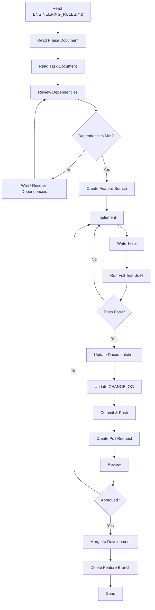

# Task Implementation Guide

> **Document Status**: ✅ MANDATORY
> **Scope**: Every implementation task MUST follow this workflow

---

## Workflow Overview



---

## Step-by-Step Guide

### Step 1 — Read Engineering Rules

Before ANY implementation:

```
Read: docs/03_Engineering/ENGINEERING_RULES.md
```

This is non-negotiable. Every rule applies to every task.

---

### Step 2 — Read Phase Document

Understand the current phase context:

```
Read: docs/05_Phases/PHASE_<XX>_<NAME>.md
```

Pay attention to:
- Phase objectives and scope
- Architecture decisions
- Dependencies on other phases/tasks
- Acceptance criteria

---

### Step 3 — Read Task Document

If a task document exists, read it completely:

```
Read: docs/06_Tasks/TASK_<ID>.md
```

If no task document exists, create one using the template:

```
Copy: docs/16_Templates/TASK_TEMPLATE.md → docs/06_Tasks/TASK_<ID>.md
```

Fill in ALL sections before proceeding to implementation.

---

### Step 4 — Review Dependencies

Check the task document's dependencies section:

- Are all prerequisite tasks completed?
- Are required libraries installed?
- Are required services running?

If dependencies are not met, resolve them first.

---

### Step 5 — Create Feature Branch

```bash
git checkout development
git pull origin development
git checkout -b feature/<phase>-<task-id>-<description>
```

Example:
```bash
git checkout -b feature/02-AUTH-001-user-orm-model
```

---

### Step 6 — Implement

Write the implementation code following:

- [Coding Standards](../15_Standards/README.md)
- Task document specifications
- Architecture constraints from the phase document

---

### Step 7 — Write Tests

Every implementation MUST include tests:

- Unit tests for individual functions and classes
- Integration tests for API endpoints
- Edge case coverage

```bash
# Run tests
cd backend
.\venv\Scripts\python.exe -m pytest -v
```

---

### Step 8 — Run Full Test Suite

ALL existing tests must continue to pass:

```bash
cd backend
.\venv\Scripts\python.exe -m pytest -v --tb=short
```

If any test fails, fix the issue before proceeding.

---

### Step 9 — Update Documentation

Update all relevant documentation:

- API specification (if endpoints changed)
- Architecture document (if design changed)
- Phase document (mark task as complete)
- Any feature-specific documentation

---

### Step 10 — Update CHANGELOG

Add an entry to `CHANGELOG.md`:

```markdown
## [Unreleased]

### Added
- <Task ID>: <Description of what was added>
```

---

### Step 11 — Commit & Push

```bash
git add .
git commit -m "<type>(<scope>): <description>"
git push origin feature/<phase>-<task-id>-<description>
```

Follow [Conventional Commits](https://www.conventionalcommits.org/) format.

---

### Step 12 — Create Pull Request

Create a PR using the [PR Template](../../.github/PULL_REQUEST_TEMPLATE.md):

- Fill in ALL sections
- Link the task document
- Include testing evidence
- Request review

---

### Step 13 — Review

Wait for review. Address any feedback:

1. Make requested changes
2. Push updates
3. Re-request review

---

### Step 14 — Merge

Once approved:

1. Squash and merge to `development`
2. Delete the feature branch (remote and local)
3. Pull latest `development`

```bash
git checkout development
git pull origin development
git branch -d feature/<branch-name>
```

---

## Quick Reference Card

| Step | Action | Command / File |
|------|--------|----------------|
| 1 | Read rules | `docs/03_Engineering/ENGINEERING_RULES.md` |
| 2 | Read phase | `docs/05_Phases/PHASE_<XX>.md` |
| 3 | Read/create task | `docs/06_Tasks/TASK_<ID>.md` |
| 4 | Check dependencies | Task document → Dependencies section |
| 5 | Branch | `git checkout -b feature/<phase>-<task>-<desc>` |
| 6 | Implement | Write code per standards |
| 7 | Test | `pytest -v` |
| 8 | Full suite | `pytest -v --tb=short` |
| 9 | Update docs | API spec, architecture, phase doc |
| 10 | CHANGELOG | `CHANGELOG.md` |
| 11 | Commit | `git commit -m "type(scope): desc"` |
| 12 | PR | Use PR template |
| 13 | Review | Address feedback |
| 14 | Merge | Squash + merge → delete branch |
