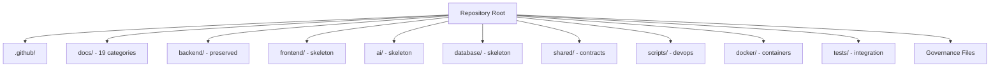

# Phase 00 — Engineering Foundation

> **Status**: ✅ Complete
> **Duration**: 2026-07-25
> **Branch**: `feature/engineering-rebase`

---

## Overview

Phase 00 establishes the engineering ecosystem that all future development must follow. This phase does NOT implement business features — it builds the governance, structure, templates, and tooling infrastructure.

---

## Objectives

1. Transform the repository from a prototype into an Enterprise Software Engineering Framework
2. Establish documentation hierarchy with 19 categorized folders
3. Define engineering rules that govern all future implementation
4. Create reusable templates for phases, tasks, PRs, issues, ADRs, and reviews
5. Configure CI/CD pipeline and Docker containerization
6. Create module skeletons for all planned services (backend, frontend, AI, database)
7. Establish Git workflow with branch naming conventions and commit standards

---

## Scope

### In Scope
- Repository restructuring and folder hierarchy
- Documentation framework (19 categories)
- Engineering governance (rules, guides, standards)
- GitHub templates (PR, 5 issue types)
- CI/CD pipeline (GitHub Actions)
- Docker configuration (Dockerfile, docker-compose)
- Module skeletons (interfaces, contracts, placeholders)
- Governance files (CHANGELOG, CONTRIBUTING, CODE_OF_CONDUCT, LICENSE)
- Git workflow documentation
- Phase documents (Phase 00–08)
- Reusable document templates (7 types)

### Out of Scope
- Business logic implementation
- API endpoint implementation
- Database migration execution
- Frontend application code
- AI/ML model integration
- Third-party service integration

---

## Architecture

This phase creates the structural architecture — not the application architecture. The application architecture is defined in [docs/architecture.md](../../docs/architecture.md).

### Structural Additions

---

## Dependencies

- None — this is the foundation phase

---

## Deliverables

| # | Deliverable | File(s) |
|---|-------------|---------|
| 1 | Repository Audit Report | `docs/audit/PROJECT_AUDIT_REPORT.md` |
| 2 | Current Problems Report | `docs/audit/CURRENT_PROBLEMS.md` |
| 3 | Repository Structure Spec | `docs/04_Architecture/REPOSITORY_STRUCTURE.md` |
| 4 | 19 Documentation Category Indexes | `docs/01_Project/` through `docs/19_Decisions/` |
| 5 | 9 Phase Documents | `docs/05_Phases/PHASE_00` through `PHASE_08` |
| 6 | Engineering Rules | `docs/03_Engineering/ENGINEERING_RULES.md` |
| 7 | Task Implementation Guide | `docs/03_Engineering/TASK_IMPLEMENTATION_GUIDE.md` |
| 8 | Git Workflow | `docs/13_Git/GIT_WORKFLOW.md` |
| 9 | PR Template | `.github/PULL_REQUEST_TEMPLATE.md` |
| 10 | 5 Issue Templates | `.github/ISSUE_TEMPLATE/` |
| 11 | 7 Document Templates | `docs/16_Templates/` |
| 12 | CI/CD Pipeline | `.github/workflows/ci.yml` |
| 13 | Docker Configuration | `docker/Dockerfile.backend`, `docker/docker-compose.yml` |
| 14 | Module Skeletons | `frontend/`, `ai/`, `database/`, `shared/`, `scripts/`, `tests/` |
| 15 | Backend Feature Skeletons | `backend/app/features/connections/` through `execution/` |
| 16 | Governance Files | `CHANGELOG.md`, `CONTRIBUTING.md`, `CODE_OF_CONDUCT.md`, `LICENSE` |

---

## Tasks

| Task ID | Description | Status |
|---------|-------------|--------|
| P00-01 | Create audit reports | ✅ |
| P00-02 | Create repository structure specification | ✅ |
| P00-03 | Create 19 documentation category indexes | ✅ |
| P00-04 | Create 9 phase documents | ✅ |
| P00-05 | Create engineering rules | ✅ |
| P00-06 | Create task implementation guide | ✅ |
| P00-07 | Create Git workflow | ✅ |
| P00-08 | Create PR template | ✅ |
| P00-09 | Create 5 issue templates | ✅ |
| P00-10 | Create 7 document templates | ✅ |
| P00-11 | Create CI/CD pipeline | ✅ |
| P00-12 | Create Docker configuration | ✅ |
| P00-13 | Create module skeletons | ✅ |
| P00-14 | Create governance files | ✅ |
| P00-15 | Update root README | ✅ |

---

## Acceptance Criteria

- [ ] All 80+ new files created with meaningful content
- [ ] Existing backend code preserved and functional
- [ ] All existing tests pass
- [ ] FastAPI server starts successfully
- [ ] Repository structure matches specification
- [ ] Every documentation category has a README index

---

## Definition of Done

- All deliverables listed above are created
- All existing tests pass without modification
- Repository structure matches `REPOSITORY_STRUCTURE.md`
- PR submitted and reviewed
- Merged to `development`

---

## Testing

- Run existing test suite: `pytest -v` — all tests must pass
- Verify server startup: `uvicorn app.main:app`
- File existence verification: all files in deliverables table exist

---

## Risks

| Risk | Mitigation |
|------|-----------|
| Existing code broken by restructuring | No source code modified — additive changes only |
| Document structure too rigid | Templates are guidelines, not straitjackets |
| Overhead perceived as excessive | Process pays dividends at scale; minimal for single tasks |

---

## Future Work

- Phase 01 through Phase 08 will follow this engineering framework
- ADR records will be created retroactively for key decisions
- CI/CD pipeline will be enhanced with deployment stages in Phase 8
