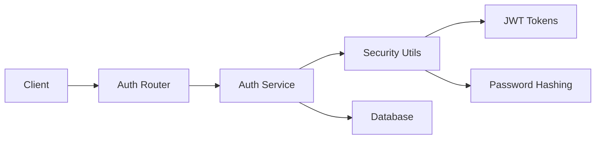

# Phase 02 — Authentication & User Management

> **Status**: 🎯 In Progress
> **Target Start**: 2026-07-25
> **Target End**: 2026-07-27
> **Dependencies**: Phase 01 ✅

---

## Overview

Phase 02 implements the authentication and user management system including user registration, login, JWT token lifecycle, and role-based access control. This phase establishes the security foundation that all subsequent phases depend on.

---

## Objectives

1. Implement User ORM model with Alembic migration
2. Create password hashing and JWT token utilities
3. Build auth service layer (register, login, refresh, profile)
4. Create FastAPI dependency guards for protected endpoints
5. Implement auth router with all endpoints
6. Achieve comprehensive test coverage for auth flows

---

## Scope

### In Scope
- User ORM model (email, hashed_password, full_name, is_active, is_superuser)
- Alembic migration for `users` table
- Auth Pydantic schemas (request/response)
- Password hashing (bcrypt via passlib)
- JWT access token (30min) and refresh token (7 days)
- Auth service layer
- Dependency guards: `get_current_user`, `get_current_superuser`
- Router endpoints: POST `/register`, POST `/login`, POST `/refresh`, GET `/me`, PUT `/me`
- Complete test suite

### Out of Scope
- OAuth2 social login (Google, GitHub)
- Email verification
- Password reset flow
- Multi-factor authentication
- Session management

---

## Architecture

---

## Dependencies

| Dependency | Type | Status |
|-----------|------|--------|
| Phase 01 — Core Foundation | Phase | ✅ Complete |
| python-jose[cryptography] | Package | ✅ Installed |
| passlib[bcrypt] | Package | ✅ Installed |

---

## Tasks

| Task ID | Description | Files | Status |
|---------|-------------|-------|--------|
| 2.1 | User ORM Model | `app/features/auth/models.py` | ✅ Complete |
| 2.2 | Alembic DB Migration | `alembic/versions/001_create_users_table.py` | ⬜ |
| 2.3 | Auth Request/Response Schemas | `app/features/auth/schemas.py` | ⬜ |
| 2.4 | Password Hashing & JWT Utils | `app/core/security.py` | ✅ Complete |
| 2.5 | Auth Service Layer | `app/features/auth/service.py` | ⬜ |
| 2.6 | Security Dependency Guards | `app/features/auth/dependencies.py` | ⬜ |
| 2.7 | Auth Router Endpoints | `app/features/auth/router.py` | ⬜ |
| 2.8 | Router Wire-up | `app/main.py` | ⬜ |
| 2.9 | Auth Test Suite | `tests/unit/test_auth_service.py`, `tests/unit/test_auth_router.py` | ⬜ |

---

## Acceptance Criteria

- [ ] User can register with email and password
- [ ] User can login and receive JWT tokens
- [ ] Access token can be refreshed using refresh token
- [ ] Protected endpoints reject unauthenticated requests
- [ ] Superuser guard restricts admin endpoints
- [ ] All existing tests continue to pass
- [ ] New auth tests cover happy path and error cases

---

## Definition of Done

- [ ] All 9 tasks completed
- [ ] All tests passing (existing + new)
- [ ] Documentation updated (API spec, CHANGELOG)
- [ ] PR reviewed and merged

---

## Testing

- Unit tests for password hashing and JWT token creation/validation
- Unit tests for auth service (register, authenticate, token refresh)
- Integration tests for all auth endpoints via HTTPX AsyncClient
- Edge cases: duplicate email, invalid credentials, expired tokens, inactive users

---

## Risks

| Risk | Probability | Impact | Mitigation |
|------|------------|--------|-----------|
| bcrypt version incompatibility | Low | High | Pin bcrypt>=4.0.0,<5.0.0 |
| JWT token validation edge cases | Medium | Medium | Comprehensive test coverage |
