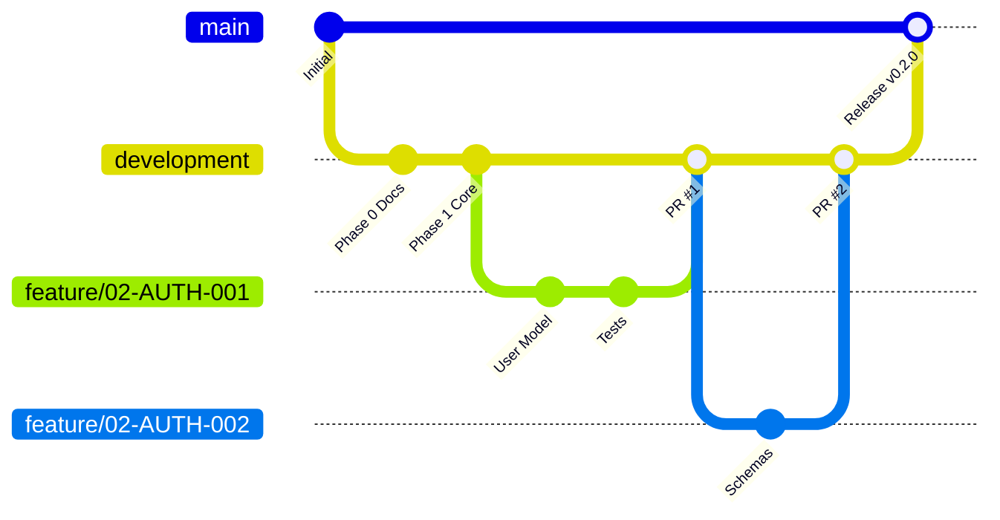
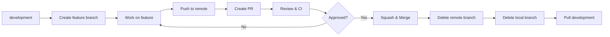

# Git Workflow — ADIP

> **Strategy**: GitHub Flow with protected main branch
> **Branch Model**: `main` ← `development` ← `feature/*`

---

## Branch Model



---

## Branch Types

### `main`
- **Purpose**: Production-only releases
- **Protection**: Direct pushes PROHIBITED
- **Merge Source**: `development` only (via release PR)
- **Naming**: `main` (immutable)

### `development`
- **Purpose**: Integration branch for feature work
- **Protection**: Direct pushes PROHIBITED
- **Merge Source**: `feature/*` branches only (via PR)
- **Naming**: `development` (immutable)

### `feature/*`
- **Purpose**: Individual task implementation
- **Lifecycle**: Created → Worked → PR → Merged → Deleted
- **Merge Target**: `development` only (via PR)
- **Naming Convention**:

```
feature/<phase-number>-<task-id>-<short-description>
```

Examples:
```
feature/02-AUTH-001-user-orm-model
feature/02-AUTH-003-auth-schemas
feature/03-CONN-001-connection-model
feature/05-EMBED-002-faiss-vector-store
```

---

## Commit Message Convention

Follow [Conventional Commits](https://www.conventionalcommits.org/) v1.0.0:

```
<type>(<scope>): <description>

[optional body]

[optional footer(s)]
```

### Types

| Type | Usage |
|------|-------|
| `feat` | New feature |
| `fix` | Bug fix |
| `docs` | Documentation only |
| `style` | Formatting, whitespace (no logic change) |
| `refactor` | Code restructuring (no feature/fix) |
| `test` | Adding or modifying tests |
| `chore` | Maintenance tasks |
| `ci` | CI/CD pipeline changes |
| `build` | Build system / dependency changes |

### Scope

Use the feature module name:
- `auth`, `connections`, `schema`, `embeddings`, `query`, `execution`
- `core`, `shared`, `database`, `config`
- `phase-00`, `phase-01`, etc. (for documentation phases)

### Examples

```bash
feat(auth): implement user registration endpoint
fix(database): resolve connection pool leak on shutdown
docs(phase-02): create authentication phase document
test(auth): add JWT token expiration edge case tests
refactor(shared): extract pagination logic to helper module
ci: add MyPy type checking to CI pipeline
chore: update dependency versions in requirements.txt
```

---

## Merge Strategy

### Feature → Development

- **Method**: Squash and Merge
- **Reason**: Keeps `development` history clean with one commit per task
- **Commit Message**: Use the PR title (formatted as conventional commit)

### Development → Main

- **Method**: Merge Commit (no squash)
- **Reason**: Preserves the full feature history in production
- **Commit Message**: `chore(release): v<version>`

---

## Branch Lifecycle



### Commands

```bash
# 1. Create branch
git checkout development
git pull origin development
git checkout -b feature/02-AUTH-001-user-orm-model

# 2. Work and commit
git add .
git commit -m "feat(auth): implement User ORM model"
git push origin feature/02-AUTH-001-user-orm-model

# 3. After PR merged — cleanup
git checkout development
git pull origin development
git branch -d feature/02-AUTH-001-user-orm-model
git push origin --delete feature/02-AUTH-001-user-orm-model
```

---

## Tags

Release tags follow semantic versioning:

```bash
git tag -a v0.2.0 -m "Release v0.2.0 — Authentication & User Management"
git push origin v0.2.0
```

---

## Rules Summary

| Rule | Description |
|------|------------|
| One task, one branch | Never combine tasks |
| Always PR | No direct pushes to `development` or `main` |
| Squash merge features | One commit per task in `development` |
| Delete after merge | Clean up feature branches immediately |
| Conventional commits | Standardized commit messages |
| Pull before branch | Always start from latest `development` |
