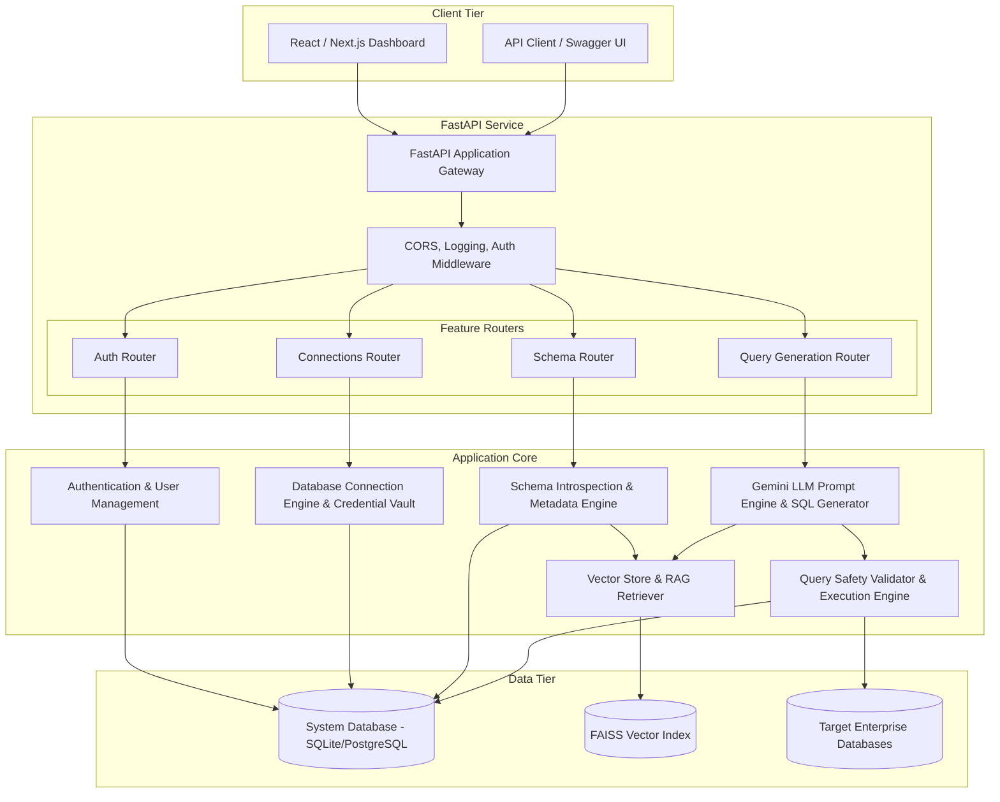

# System Architecture & Technical Design

## Overview

The **AI Data Intelligence Platform (ADIP)** is an enterprise-grade solution designed to translate natural language user queries into precise, safe, and efficient SQL queries against heterogeneous target databases (SQLite, PostgreSQL, MySQL).

The platform uses a Retrieval-Augmented Generation (RAG) architecture powered by Google's Gemini LLM engine. Schema metadata, column descriptions, and relationship constraints are indexed and dynamically injected into LLM prompts to produce syntactically valid and domain-aware SQL queries.

---

## High-Level Topology

---

## Core Component Breakdown

### 1. Application Gateway & API Tier (`app/main.py`)
- Built on **FastAPI** using asynchronous handlers (`async/await`).
- Request tracing via custom UUID request headers.
- Global exception handling providing unified JSON responses (`SuccessResponse[T]`, `ErrorResponse`).

### 2. Authentication & User Management (`app/features/auth`)
- **OAuth2 Bearer JWT** security architecture.
- Password hashing using **Argon2 / bcrypt**.
- Access Token (short-lived, 30m) + Refresh Token (long-lived, 7d) lifecycle.
- Role-based access control (Standard User, Active Admin/Superuser).

### 3. Database Connection Engine (`app/features/connections`)
- Secure storage of connection parameters for external databases (PostgreSQL, MySQL, SQLite).
- Fernet-based symmetric encryption for sensitive connection secrets/passwords.
- Asynchronous connection pool creation using SQLAlchemy Async Engine.

### 4. Schema Introspection Engine (`app/features/schema`)
- Automated introspection of tables, views, columns, data types, primary keys, and foreign keys.
- Continuous background schema synchronization.
- JSON-schema object representation formatted for LLM prompt context injection.

### 5. Vector Store & RAG Retriever (`app/features/embeddings`)
- High-density semantic vector embeddings generated using sentence-transformers (`all-MiniLM-L6-v2`).
- **FAISS** vector database for fast similarity search across large enterprise schemas (matching table/column descriptions against user queries).

### 6. Gemini LLM Text-to-SQL Engine (`app/features/query`)
- Prompt construction incorporating user query, relevant schema context retrieved via RAG, database dialect constraints, and sample data.
- Integration with **Google Gemini API** (`gemini-1.5-flash` / `gemini-1.5-pro`).
- Response parsing to extract valid SQL blocks and explanation notes.

### 7. SQL Execution Safety & Guardrails (`app/features/execution`)
- **Abstract Syntax Tree (AST) Parsing**: Strict verification that generated SQL contains read-only operations (`SELECT`). Rejection of `DROP`, `DELETE`, `UPDATE`, `INSERT`, `ALTER`, `TRUNCATE`, and multi-statement injection attempts.
- Query timeout enforcement and row-limit caps.
- Structured result formatting (Column headers, rows, execution time metrics).

---

## Security Architecture

> [!IMPORTANT]
> - **Credential Protection**: All target database credentials are encrypted prior to persistence using Fernet symmetric encryption.
> - **SQL Injection Prevention**: Target queries are executed using parameter binding or read-only connection pools.
> - **Query Isolation**: Users can only execute queries against database connections they own or have explicit RBAC access to view.

---

## Tech Stack Summary

| Layer | Technology / Library |
| :--- | :--- |
| **Framework** | FastAPI, Uvicorn |
| **Language** | Python 3.12+ |
| **ORM / Database Layer** | SQLAlchemy 2.0 (Async), Alembic, aiosqlite |
| **Validation & Settings** | Pydantic v2, Pydantic-Settings |
| **Security & Auth** | PyJWT, Passlib (Bcrypt / Argon2), Cryptography (Fernet) |
| **LLM Provider** | Google Gemini API (`google-generativeai`) |
| **Embeddings & Vector Store** | Sentence-Transformers, FAISS |
| **Testing** | Pytest, pytest-asyncio, pytest-cov, HTTPX |
