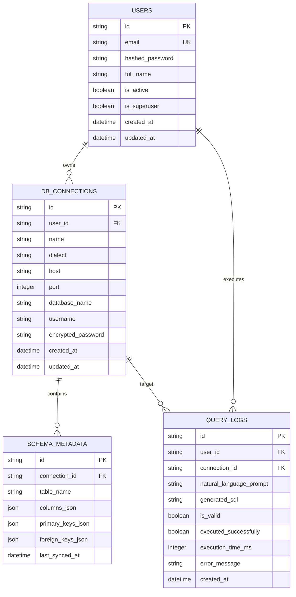

# Internal System Database Schema & Data Models

## Overview

The internal system database stores platform state, user accounts, database connection parameters, schema metadata, and natural language query execution logs.

---

## Entity-Relationship Diagram (ERD)

---

## Table Specifications

### 1. `users`
Stores user identity, security attributes, and authorization roles.

| Column | Type | Constraints | Description |
| :--- | :--- | :--- | :--- |
| `id` | VARCHAR(36) | PRIMARY KEY | UUIDv4 identifier string |
| `email` | VARCHAR(255) | UNIQUE, NOT NULL, INDEX | User login email address |
| `hashed_password` | VARCHAR(255) | NOT NULL | Argon2 / Bcrypt hashed password string |
| `full_name` | VARCHAR(255) | NULLABLE | User display name |
| `is_active` | BOOLEAN | DEFAULT TRUE, NOT NULL | Account active status |
| `is_superuser` | BOOLEAN | DEFAULT FALSE, NOT NULL | Administrative privilege flag |
| `created_at` | DATETIME | NOT NULL | Account creation timestamp (UTC) |
| `updated_at` | DATETIME | NOT NULL | Last account update timestamp (UTC) |

---

### 2. `db_connections`
Stores encrypted connection metadata for external databases targetted by Text-to-SQL queries.

| Column | Type | Constraints | Description |
| :--- | :--- | :--- | :--- |
| `id` | VARCHAR(36) | PRIMARY KEY | UUIDv4 connection identifier |
| `user_id` | VARCHAR(36) | FOREIGN KEY (`users.id`) | Owner user ID |
| `name` | VARCHAR(100) | NOT NULL | Friendly display name |
| `dialect` | VARCHAR(50) | NOT NULL | Database type (`sqlite`, `postgresql`, `mysql`) |
| `host` | VARCHAR(255) | NULLABLE | Hostname / IP address |
| `port` | INTEGER | NULLABLE | Port number |
| `database_name` | VARCHAR(255) | NOT NULL | Target database name or path |
| `username` | VARCHAR(255) | NULLABLE | Authentication username |
| `encrypted_password` | TEXT | NULLABLE | Fernet-encrypted password string |
| `created_at` | DATETIME | NOT NULL | Connection creation timestamp (UTC) |
| `updated_at` | DATETIME | NOT NULL | Last update timestamp (UTC) |

---

### 3. `schema_metadata`
Stores introspected metadata for connected databases to facilitate fast schema rendering and RAG vector generation.

| Column | Type | Constraints | Description |
| :--- | :--- | :--- | :--- |
| `id` | VARCHAR(36) | PRIMARY KEY | UUIDv4 metadata record identifier |
| `connection_id` | VARCHAR(36) | FOREIGN KEY (`db_connections.id`) | Target connection ID |
| `table_name` | VARCHAR(255) | NOT NULL | Table or View name |
| `columns_json` | JSON | NOT NULL | Array of column objects (name, type, nullable, description) |
| `primary_keys_json` | JSON | NOT NULL | Array of primary key column names |
| `foreign_keys_json` | JSON | NOT NULL | Array of foreign key constraint definitions |
| `last_synced_at` | DATETIME | NOT NULL | Timestamp when schema was last introspected |

---

### 4. `query_logs`
Logs all user prompts, generated SQL, validation status, and execution performance metrics.

| Column | Type | Constraints | Description |
| :--- | :--- | :--- | :--- |
| `id` | VARCHAR(36) | PRIMARY KEY | UUIDv4 query log entry ID |
| `user_id` | VARCHAR(36) | FOREIGN KEY (`users.id`) | Requesting user ID |
| `connection_id` | VARCHAR(36) | FOREIGN KEY (`db_connections.id`) | Target database connection ID |
| `natural_language_prompt` | TEXT | NOT NULL | Original user query in plain text |
| `generated_sql` | TEXT | NULLABLE | SQL statement produced by Gemini LLM |
| `is_valid` | BOOLEAN | DEFAULT FALSE | Whether AST safety check passed |
| `executed_successfully` | BOOLEAN | DEFAULT FALSE | Whether target database execution succeeded |
| `execution_time_ms` | INTEGER | NULLABLE | Latency in milliseconds |
| `error_message` | TEXT | NULLABLE | Parsing or execution error message |
| `created_at` | DATETIME | NOT NULL | Timestamp when query was initiated |
