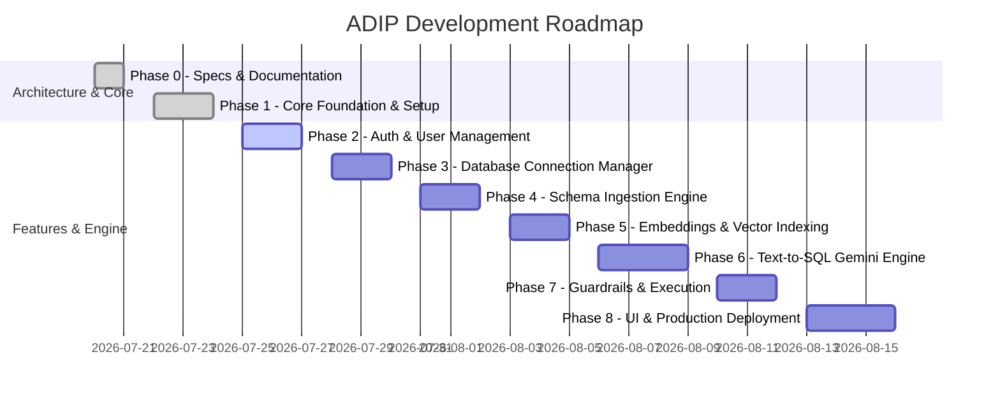

# Product Requirements Document & Multi-Phase Roadmap

## Product Overview

The **AI Data Intelligence Platform (ADIP)** aims to democratize enterprise database access by enabling non-technical stakeholders, business analysts, and developers to query complex SQL databases using natural language.

### Core Objectives
1. **Accuracy**: Generate accurate SQL queries by incorporating domain-specific schema context via RAG.
2. **Security**: Guarantee read-only execution guardrails to prevent data mutation or deletion.
3. **Speed**: Sub-second schema context retrieval and fast LLM SQL generation.
4. **Extensibility**: Support multiple SQL dialects (SQLite, PostgreSQL, MySQL, Snowflake).

---

## Detailed Multi-Phase Roadmap

---

## Deliverables by Phase

### Phase 0: System Architecture & Technical Documentation Suite ✅
- Architecture Overview & System Topology (`docs/architecture.md`)
- Product Requirements & Multi-Phase Roadmap (`docs/prd_and_roadmap.md`)
- Relational Database Schema Design & ERD (`docs/database_schema.md`)
- REST API Specification (`docs/api_specification.md`)
- Task-Wise Implementation Execution Plan (`docs/task_wise_implementation_plan.md`)
- Root Repository README (`README.md`)

### Phase 1: Core Foundation & Shared Services ✅
- FastAPI Application Factory (`app/main.py`)
- Environment Configuration via Pydantic Settings (`app/core/config.py`)
- Centralized Exception Infrastructure (`app/core/exceptions.py`)
- Shared Pydantic Base Schemas & Utilities (`app/shared/schemas.py`, `app/shared/utils.py`)
- Database Initialization & Session Factory (`app/core/database.py`)
- Unit & Integration Test Suite (63 passing tests)

### Phase 2: Authentication & User Management (Current Target 🎯)
- SQLAlchemy User Model & Alembic Migration
- Password Hashing (Argon2 / Bcrypt) & JWT Token Generation
- Endpoints: `/api/v1/auth/register`, `/api/v1/auth/login`, `/api/v1/auth/refresh`, `/api/v1/auth/me`
- Dependency Guards: `get_current_user`, `get_current_superuser`

### Phase 3: Database Connection Management
- Connection Metadata Model & Encrypted Password Vault
- Connection string testing & dynamic engine pooling
- Supported Dialects: SQLite, PostgreSQL, MySQL
- Endpoints: CRUD operations on database connections and health connectivity checks

### Phase 4: Schema Ingestion & Introspection Engine
- Automated Schema Extraction (Tables, Columns, Types, Keys, Relationships)
- Background Schema Sync Jobs
- Schema Export for LLM Prompt formatting

### Phase 5: Embeddings & Vector Indexing
- Sentence-Transformers embedding generation for schema elements
- FAISS vector store initialization & persistence
- Top-K semantic schema retriever for query context construction

### Phase 6: Gemini LLM Text-to-SQL Engine
- Prompt Engineering Pipeline (System context, Schema context, Dialect guidelines, Few-shot examples)
- Integration with Google Gemini API (`gemini-1.5-flash`)
- SQL Extraction & Explanation parsing

### Phase 7: SQL Execution Safety & Guardrails
- SQL AST Validation (Read-only AST checker blocking non-SELECT queries)
- Query execution engine with timeout caps and row limits
- Result formatting & Execution telemetry logging

### Phase 8: Dashboard UI & Production Deployment
- Web Interface (React / Next.js)
- Docker containerization & production docker-compose deployment
- End-to-end user workflows
